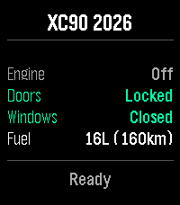
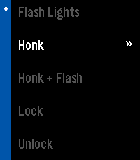

# ReVolver

**Re**mote **Vol**vo controll**er** — also _volver_ (Spanish): "to return/come back" to your car :)

Remote control your Volvo from your Pebble smartwatch.

## Features

- ⚡ Flash exterior lights
- 📯 Honk / Honk + Flash
- 🔒 Lock / Unlock doors
- ❄️ Climate on / off
- 🚗 Engine start / stop (with duration picker)
- 📊 Live dashboard: engine, doors, windows, fuel/battery & range
- 🔄 Loading spinner while fetching data
- 🔔 Haptic feedback on command result (configurable)
- 🎯 Dynamic command menu (only shows what your car supports)
- 🔐 Confirmation prompts for sensitive actions (unlock, engine start)
- 🚀 Quick Launch: run one chosen action (e.g. climate on) straight from a watch button

## Screenshots

<p align="center">
  
  &nbsp;&nbsp;
  
</p>

## Supported Platforms

- Aplite (Pebble Classic)
- Basalt (Pebble Time)
- Chalk (Pebble Time Round)
- Diorite (Pebble 2)
- Emery (Pebble Time 2)
- Flint (Pebble 2 Duo)
- Gabbro (Pebble Round 2)

## How It Works

```
Pebble Watch ←BT→ Phone (PebbleKit JS) ←HTTPS→ Volvo Connected Vehicle API
                         ↕
                   AWS Lambda (OAuth token exchange)
```

1. User authenticates once with Volvo ID (OAuth2 + PKCE), in the phone's browser
2. Tokens reach the phone through a short-lived pairing (DynamoDB, up to 10 min), then are stored on the phone and auto-refreshed when expired
3. Commands sent directly to Volvo API from phone JS
4. Watch displays status and sends command requests over Bluetooth

## Project Layout

```
src/c/main.c             Entry point
src/c/modules/           Messaging, command menu, Quick Launch
src/c/windows/           Main window UI
src/pkjs/index.js        Phone JS — API calls, token management, commands
src/pkjs/config.json     Clay settings page (VIN, vibration, Quick Launch, login link)
auth/                    OAuth frontend (synced to ReVolverAuth repo)
infra/                   AWS CDK stack (Lambda token exchange + DynamoDB pairing table)
  infra/lambda/          Lambda function code
  infra/lib/             CDK stack definition
doc/                     Documentation
resources/images/        App icon and screenshots
```

## Building

```bash
pebble build                        # Build for all platforms
pebble install --emulator basalt    # Install on emulator
```

## Setup

### 1. Volvo Developer Account

Register at https://developer.volvocars.com and create an application to get:

- Client ID (`vid-dc-…`)
- Client Secret
- VCC API Key

When creating it:

- **Redirect URI:** the auth page URL, exactly, with the trailing slash (e.g. `https://piotrserafin.github.io/ReVolverAuth/`). It can't be changed after the application is created.
- **Scopes:** enable every scope listed in [doc/scopes.md](doc/scopes.md). Don't add `offline_access`: Volvo's login rejects it.

### 2. Deploy Auth Backend

```bash
# Store secrets in AWS SSM (one time)
aws ssm put-parameter --name /revolver/client-id --value "..." --type SecureString
aws ssm put-parameter --name /revolver/client-secret --value "..." --type SecureString
aws ssm put-parameter --name /revolver/vcc-api-key --value "..." --type SecureString
aws ssm put-parameter --name /revolver/redirect-uri --value "https://piotrserafin.github.io/ReVolverAuth/" --type String
aws ssm put-parameter --name /revolver/allowed-origins --value "https://piotrserafin.github.io,https://piotrserafin.dev" --type String
aws ssm put-parameter --name /revolver/scopes --value "openid conve:... energy:... location:read" --type String  # space-separated, see doc/scopes.md

# Deploy Lambda
cd infra
python3 -m venv .venv && source .venv/bin/activate
pip install -r requirements.txt
cdk deploy
```

`scopes` is required: the login page refuses to start without it. The Volvo login endpoints default to `auth.volvocars.com`; override them with `/revolver/auth-endpoint` and `/revolver/token-endpoint` only if needed. More in [infra/lambda/README.md](infra/lambda/README.md).

### 3. Install on Watch

```bash
pebble build
pebble install --phone <IP>
```

### 4. Configure

1. Open ReVolver settings on phone (Pebble app → ReVolver → Settings)
2. Enter your VIN
3. Tap "Log in with Volvo ID", then "Log in with Volvo ID in browser"
4. Log in with your Volvo ID in the browser
5. Go back to the Pebble app — the watch shows "Logged in!", then "Ready"

Keep ReVolver open on the watch while logging in. "Log in here instead" uses the login inside the Pebble app, which currently shows a blank page on Android ([coredevices/mobileapp#507](https://github.com/coredevices/mobileapp/issues/507)).

## Usage

- **UP** — Refresh car status
- **SELECT** — Open command menu
- **Pick a command** — Executes immediately, status shows result
- **Vibration** — single pulse = success, double = error
- **Quick Launch** — in ReVolver settings, pick an action under "Quick Launch"; on the watch, assign ReVolver to a button in Settings → Quick Launch. Holding that button runs the action without confirmation (Unlock can't be chosen).

## Documentation

| Document                       | Content                                  |
| ------------------------------ | ---------------------------------------- |
| [doc/api.md](doc/api.md)       | Volvo API endpoints and response formats |
| [doc/scopes.md](doc/scopes.md) | Volvo OAuth scopes reference             |
| [infra/lambda/README.md](infra/lambda/README.md) | Lambda API, deploy, dev stack |
| [doc/features.md](doc/features.md) | Feature plans and status |
| [PRIVACY.md](PRIVACY.md) | What data goes where |
| [doc/connected-vehicle-c3-specification.json](doc/connected-vehicle-c3-specification.json) | Connected Vehicle API OpenAPI spec (v2)  |
| [doc/energy-api-specification.json](doc/energy-api-specification.json) | Energy API OpenAPI spec (v2)             |
| [doc/location-specification.json](doc/location-specification.json) | Location API OpenAPI spec (v1) |

## Security

- `client_secret` never leaves AWS (stored in SSM, used by Lambda only)
- Volvo requires client_secret (not pure PKCE) — server-side proxy is mandatory
- OAuth2 PKCE prevents authorization code interception
- VCC API key delivered with tokens (not hardcoded in app)
- Browser login: tokens wait for the phone in DynamoDB (encrypted, max 10 min, single use, only for the holder of a one-time secret); the browser never receives them
- Lambda wrapped in try/catch to prevent secret leaks in CloudWatch
- All communication over HTTPS
- No secrets in source code or app binary
- See [PRIVACY.md](PRIVACY.md) for full details

## Support

ReVolver is free and made in my spare time. If it makes your mornings a bit warmer, you can [buy me a coffee on Ko-fi](https://ko-fi.com/bartebly) ☕

## License

MIT
